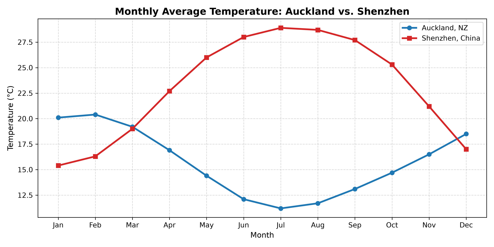
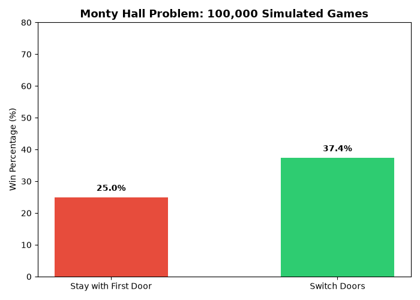
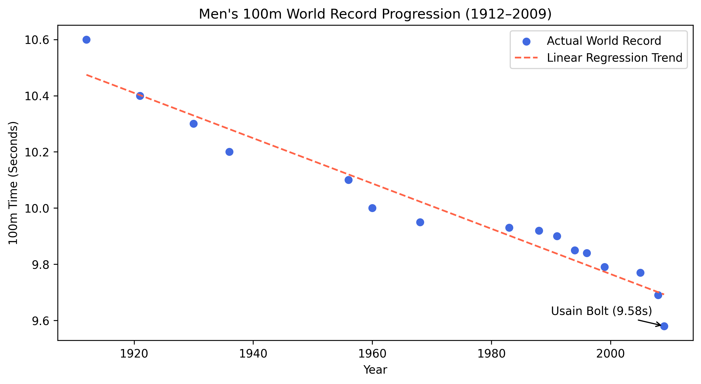

# Python Data Science Starter

A collection of Python scripts exploring data analysis, loops, and probability simulations.

## Projects
- **dice_chart.py**: Simulates 10,000 rolls of two six-sided dice and visualizes the normal probability distribution of sums (2–12) using a terminal bar chart.
- **line_finder.py**: Interactive IGCSE math tool that calculates the gradient ($m$), y-intercept ($c$), and linear equation ($y = mx + c$) from any two coordinate points.
- **grade_analyzer.py**: Reads student exam data from `scores.csv`, calculates subject averages, and identifies the top performer.
- **pi_estimator.py**: Uses a Monte Carlo random dart simulation and coordinate geometry ($x^2 + y^2 \le 1$) to approximate $\pi$ and measure margin of error.
- **pie_visual.py**: Renders a live 2D geometric animation using Python `turtle` to visualize Monte Carlo dart throws inside and outside an inscribed circle.
- **climate_analyzer.py**: Compares 12-month climate datasets (`climate_data.csv`) between Auckland and Shenzhen to calculate annual averages, seasonal swings, and hemispheric temperature gaps.
- **climate_chart.py**: Plots a dual time-series line graph comparing 12 months of Auckland and Shenzhen temperatures from `climate_data.csv` using Python `turtle`.
- **trend_predictor.py**: Implements Ordinary Least Squares linear regression ($y = mx + c$) and Pearson correlation ($r$) from scratch to predict exam scores from study hours.
- **regression_plot.py**: Renders a visual scatter plot, Least Squares line of best fit ($y = mx + c$), and predicted outcome point using Python `turtle`.
- **aukland_vs_shenzhen.py**: Analyzes 12-month climate data with `pandas` and generates a high-resolution comparison chart using `matplotlib`.
- **monty_hall.py**: Simulates 10,000 rounds of the Monty Hall game show problem to prove mathematically why switching doors wins ~66.7% of the time vs. ~33.3% when staying.
- **dj_track_matcher.py**: Algorithmic DJ transition analyzer using BPM percentage drift, half-time/double-time detection, and Camelot Wheel harmonic key matching. 
### Featured Visualization: Auckland vs. Shenzhen Temperature

### Featured Visualization: Monty Hall Simulation

## Men's 100m World Record Progression (1912–2009)
Using `pandas` and `scikit-learn`, this project analyzes ratified electronic/official Men's 100m world records and fits a linear regression trendline to project future performance.

* **Key Findings:** Record times dropped from 10.60s (1912) to Usain Bolt's 9.58s (2009), reaching an average speed of 10.44 m/s. While a straight-line trend projects 9.54s by 2028, real human sprinting speed approaches a biological limit.
* **Notebook:** [`100m_world_record_analysis_ipynb_.ipynb`](./100m_world_record_analysis_ipynb_.ipynb)

### TCM Clinical Case Exam Trainer (`tcm_exam_trainer.py`)
An interactive command-line study tool built to train Traditional Chinese Medicine (TCM) pattern differentiation and herbal formula prescription.
* **Structured Clinical Records:** Stores multi-attribute case dictionaries (`category`, `symptoms`, `tongue_pulse`, `pattern`, `formula`, and clinical rationale).
* **Dual-Criteria Grading & Normalization:** Standardizes user text input (`clean_text`) to combine flexible keyword matching for diagnostic patterns with exact matching for classical formulas.
* **Adaptive Mastery Retry Queue:** Uses a `while`-loop spaced-repetition queue and `random.shuffle` to randomize case order and re-test only missed cases until 100% mastery is achieved, tracking first-attempt exam accuracy.
  
### Smart Exam Score & Study Hour Optimizer (`study_forecaster.py`)
A greedy optimization model that allocates a limited pre-exam study budget across multiple subjects to maximize overall grade improvement.
* **Diminishing Marginal Returns:** Models realistic study fatigue by decaying each subject's hourly grade gain by 10% per consecutive hour (`0.9 ** hours`)
* **Target-Weighted Greedy Allocation:** Evaluates marginal score gain per hour across nested subject dictionaries, applying a `1.5x` priority multiplier to subjects below their target grade while capping scores at `100%`
* **Before-and-After Forecast Reporting:** Generates an aligned CLI summary comparing baseline grades, allocated hours, predicted scores, target completion status, and overall GPA lift

### Rolling Z-Score Air Quality Anomaly Detector (`anomaly_detector.py`)
A time-series anomaly detection script that flags sudden environmental pollution spikes from scratch using sliding-window statistics.
* **Leakage-Free Sliding Windows:** Evaluates each daily PM2.5 reading strictly against the prior 5-day moving baseline (`data[i - window_size : i]`) so extreme spikes do not inflate their own reference mean or standard deviation.
* **Scratch-Built Z-Score Engine:** Computes rolling mean, population standard deviation, and standardized Z-scores ($Z = \frac{x - \mu}{\sigma}$) using pure Python and the `math` module.
* **Automated Threshold Alerting:** Flags statistical outliers exceeding $|Z| \ge 2.0$ and outputs an aligned daily diagnostic summary.

### Monte Carlo Savings & Goal Risk Simulator (`budget_simulator.py`)
A stochastic financial forecasting model that runs 5,000 randomized 12-month savings timelines to quantify the probability of hitting a target savings goal under spending volatility.
* **Gaussian Expense Modeling:** Samples monthly expenditures from a normal distribution (`random.gauss`) with a minimum spending floor (`max(250, ...)`).
* **Percentile Risk Analysis:** Sorts simulated outcomes to extract `P10` (worst-case), `P50` (median), and `P90` (best-case) ending balances alongside overall goal-completion probability.
